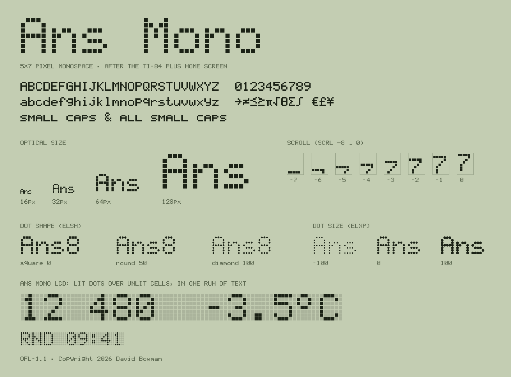

# Ans Mono

A 5×7 pixel monospace after the TI-84 Plus home screen. 192 characters plus 26 small caps, an **unlit-cell** layer for LCD-style readouts, a variable **optical size** axis that opens the LCD dot grid as type gets bigger, and an optional **scroll** axis that rolls characters in row by row.



## What's in the box

```
css/
  ans-mono.css                     @font-face by URL + helper classes           0.7 KB
  ans-mono.embedded.css            same, font embedded as a data: URI           6.6 KB
  ans-mono-scroll.css              numerals with the scroll axis, by URL        1.4 KB  (opt-in)
  ans-mono-scroll.embedded.css     same, embedded                              20.6 KB  (opt-in)
fonts/
  web/       AnsMono-VF.woff2                    core: opsz axis               4.4 KB
             AnsMono-Regular.woff2               static, solid                  3.6 KB
             AnsMono-Numerals-Scroll-VF.woff2    numerals: opsz + SCRL         14.5 KB
             AnsMono-Scroll-VF.woff2             everything: opsz + SCRL       48.5 KB
  variable/  AnsMono-VF.ttf, AnsMono-Scroll-VF.ttf          desktop variable fonts
  otf/       AnsMono-Text / SmallDisplay / Display / Poster .otf   desktop static (CFF)
source/      glyph bitmaps and build scripts
```

## Web

Pick one stylesheet:

```html
<!-- Bundled asset: browser fetches fonts/web/AnsMono-VF.woff2 (4.4 KB) -->
<link rel="stylesheet" href="ans-mono/css/ans-mono.css">

<!-- No font request at all: the font is inside the CSS -->
<link rel="stylesheet" href="ans-mono/css/ans-mono.embedded.css">
```

```css
.headline { font-family: "Ans Mono", ui-monospace, monospace; font-variant-numeric: tabular-nums; }
/* or just use the helper class: class="ans-mono" */
```

Use the embedded version for overlays, extensions and anything injected into pages you don't control. The page doesn't need to serve or fetch a font file, so the type can't fall back to a system font because of a missing or blocked asset.

### Optical size (`opsz`, 8–144)

The browser sets it from the font size automatically (`font-optical-sizing: auto`):

| Size | Look |
|---|---|
| up to 16px | solid letters |
| 32px | hairline gaps between dots |
| 72px | clear dot grid |
| 144px+ | widest gaps (~20% of the dot pitch) |

Keep it solid at any size with `font-optical-sizing: none`, or force a look with `font-variation-settings: "opsz" 144`.

**Crisp sizes:** the em is 8 dots tall, so multiples of 8 px (8, 16, 24, 32 …) put every dot on whole pixels.

### Small caps

```css
.label { font-variant-caps: all-small-caps; }   /* VISITORS → small caps */
.title { font-variant-caps: small-caps; }       /* lowercase → small caps, capitals stay */
```

Small caps are drawn 5 dots tall on the lowercase body (OpenType `smcp` and `c2sc`). The helper class `.ans-mono-sc` applies `all-small-caps`.

### LCD readouts: lit over unlit

Real LCDs show their unlit pixels. Stylistic set 1 (`ss01`, "Unlit cells") turns every character into a block of dots exactly as wide as itself, spaces included. Set the same text twice, with the back copy in a lighter colour, and the unlit grid lines up dot for dot with the lit one. Thin spaces get thin strips of unlit dots. Nothing needs trimming or spacing by hand.

One element does both layers (`.ans-mono-readout` draws the unlit copy from `data-text`):

```html
<span class="ans-mono ans-mono-readout" data-text="12 480">12 480</span>
```

```css
.ans-mono-readout { --ans-mono-unlit: #B1BB9F; }   /* default: currentColor at 12% */
```

Or build the two layers yourself, with `font-feature-settings: "ss01"` (or `.ans-mono-unlit`) on the back copy. For a rolling readout, add `ans-mono-roll` next to `ans-mono-readout`: the digits roll while the unlit grid stays still.

### Spaces

Spaces come in whole-dot widths, so readouts can be spaced precisely. They're wider or narrower than a cell, so they break the monospace grid on purpose. Use them in readouts and UI text, not in code.

| Character | Dots | | Character | Dots |
|---|---|---|---|---|
| U+200A hair space | 1 | | U+2002 en space | 4 |
| U+2006 six-per-em space | 1 | | U+0020 space, U+00A0 no-break | 6 |
| U+2009 thin space | 2 | | U+2007 figure space (= a digit) | 6 |
| U+202F narrow no-break space | 2 | | U+2008 punctuation space | 6 |
| U+2005 four-per-em space | 2 | | U+2003 em space | 8 |
| U+2004 three-per-em space | 3 | | U+205F medium math space | 2 |

### Cell graphics

Drawn on the full 6×8 cell, so they tile into continuous bars and fields:

| | Characters |
|---|---|
| Full cell | █ |
| Lower fills (1–7 rows) | ▁ ▂ ▃ ▄ ▅ ▆ ▇ |
| Upper fills (1–7 rows) | ▔ U+1FB82 U+1FB83 ▀ U+1FB84 U+1FB85 U+1FB86 |
| Single dot row, top to bottom | ▔ U+1FB76 U+1FB77 U+1FB78 U+1FB79 U+1FB7A U+1FB7B ▁ |
| Single dot column, left to right | ▏ U+1FB70 U+1FB72 U+1FB73 U+1FB74 ▕ |
| Left fills | ▏(1) ▎(2) ▍(2) ▌(3) ▋(4) ▊(5) ▉(5) |
| Right fills | ▕(1) U+1FB87(2) U+1FB88(2) ▐(3) U+1FB89(4) U+1FB8A(5) U+1FB8B(5) |
| Quadrants (3×4 dots) | ▖ ▗ ▘ ▝ ▙ ▚ ▛ ▜ ▞ ▟ |
| Shades | ░ (1 dot in 4) ▒ (checkerboard) ▓ (3 in 4) |

The cell is 8 dots tall, so vertical eighths are exact, which makes the lower fills right for bar charts and sparklines. It is 6 dots wide, so Unicode's horizontal eighths share columns: U+1FB71 draws the same as U+1FB70, and U+1FB75 the same as U+1FB74. Use the column characters listed above for distinct columns.

### Scroll (`SCRL`, −8 to 8): opt-in

Characters slide through a fixed 8-row window by switching dots on and off. The grid never moves.

| Animate | Effect |
|---|---|
| −8 → 0 | rises in from below |
| 8 → 0 | drops in from above |
| 0 → 8 | scrolls out the top |
| 0 → −8 | drops out the bottom |

Values snap to whole rows, so a plain linear animation steps one dot row at a time and never shows half-lit dots.

```html
<link rel="stylesheet" href="ans-mono/css/ans-mono.css">
<link rel="stylesheet" href="ans-mono/css/ans-mono-scroll.css">

<span class="ans-mono-roll">
  <span style="--i:0">1</span><span style="--i:1">2</span><span style="--i:2">,</span><span style="--i:3">4</span>…
</span>
```

```css
.ans-mono-roll > span {
  display: inline-block;
  animation: ans-mono-rise .8s linear both;     /* 8 rows ≈ 100 ms per row */
  animation-delay: calc(var(--i) * 60ms);
}
```

`ans-mono-scroll.css` loads only the numerals subset (digits, separators, `% + − – ( ) / # ×`, currency, `k K M B b`). Anything else in the element falls through to the core font. If you need to scroll letters, point an `@font-face` at `fonts/web/AnsMono-Scroll-VF.woff2` instead. The stylesheet turns the animation off under `prefers-reduced-motion`.

## Desktop

Install **either** the static OTFs **or** the variable TTF, not both. They share family names, so having both installed can confuse font menus.

- **`fonts/otf/`** works in every app. Four styles, one per optical size: Text (solid), Small Display, Display, Poster. Apps that support typographic families group them under *Ans Mono*; others list *Ans Mono Text*, *Ans Mono Display* and so on.
- **`fonts/variable/AnsMono-VF.ttf`** is for apps with variable-font support (Figma, Adobe, Affinity, Sketch). It has an Optical size slider and the same four named styles. `AnsMono-Scroll-VF.ttf` adds the Scroll axis for motion work.

Small caps: turn on *Small Capitals* / *All Small Caps* in the app's OpenType panel. Unlit cells: *Stylistic Set 1*.

## Building

Everything in `fonts/` and `css/` is generated from `source/glyphs.py`, where each glyph is a 5×7 grid of `#` and `.`.

```sh
pip install -r requirements.txt
./build.sh                 # fonts + css; also runs the scroll-axis check
python3 source/specimen.py # optional: regenerate docs/specimen.png (needs Pillow)
```

The build is reproducible: unchanged sources rebuild byte-for-byte, so diffs in `fonts/` only appear when glyphs or build settings change. Version, copyright and licence strings live in `source/version.py`.

| Script | Does |
|---|---|
| `source/glyphs.py` | glyph bitmaps (`G`), small caps (`SC`), space widths (`W`) |
| `source/features.py` | advance widths, unlit-cell glyphs and the OpenType features (smcp, c2sc, ss01) |
| `source/build.py` | static font with merged outlines |
| `source/build_vf.py` | variable font; `--scroll` adds the SCRL axis |
| `source/verify.py` | checks every dot of every glyph across 9 sizes × 13 scroll values (no specks, no partial dots); fails the build otherwise |
| `source/build_otf.py` | static CFF `.otf` per named optical size |
| `source/make_css.py` | the four stylesheets |

## Licence

Copyright 2026 David Bowman. Licensed under the [SIL Open Font License 1.1](OFL.txt). You can use, embed, modify and redistribute the fonts, including commercially. You can't sell the fonts on their own, and modified versions must stay under the OFL.
